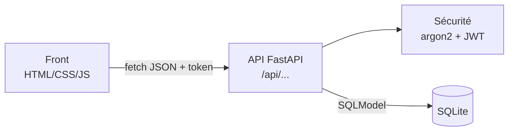

\# 4a-isi-projet-back — Pol-eat-heck


API back-end de l'application \*\*Pol-eat-heck\*\* : menus à la semaine et système de réservation.

Développée en \*\*Python / FastAPI\*\*, avec une base \*\*SQLite\*\*.


\## Collaborateurs

\- Meina EL Khattat — Base de données

\- Nour EL Houda Bouslimi — Back-end

\- Jude HOUANSOU — Front-end


\## Projets liés

\- Base de données : https://github.com/Nour-Bouslimi/4a-isi-projet-db

\- Front-end : https://github.com/Nour-Bouslimi/4a-isi-projet-front


\## Installation (Windows, cmd)

```cmd

git clone https://github.com/Nour-Bouslimi/4a-isi-projet-back.git

cd 4a-isi-projet-back

python -m venv .venv

.venv\\Scripts\\activate.bat

pip install -r requirements.txt
python init_db.py

```


\## Lancer le serveur

```cmd

fastapi dev app/main.py

```

\- API : http://127.0.0.1:8000/api/

\- Documentation interactive (Swagger) : http://127.0.0.1:8000/docs


\## Dépendances

| Paquet | Rôle |

|---|---|

| `fastapi\[standard]` | Framework web, serveur uvicorn, doc `/docs` |

| `sqlmodel` | ORM : classes Python ↔ tables SQLite |

| `pyjwt` | Tokens d'authentification JWT |

| `pwdlib\[argon2]` | Hachage des mots de passe |

| `pytest` | Tests automatiques |


\## Conception


\### Architecture




\### Structure du projet

```
4a-isi-projet-back/
├── app/
│   ├── main.py              # point d'entrée, CORS, branchement des routers
│   ├── config.py            # paramètres (URL base, clé secrète JWT)
│   ├── database.py          # connexion SQLite, session par requête
│   ├── models.py            # les 7 tables, miroir de db/schema.sql
│   ├── schemas.py           # données de l'API quand elles diffèrent des tables
│   ├── security.py          # hachage argon2, génération de mot de passe, tokens JWT
│   ├── dependances.py       # contrôle d'accès : connecté / actif (non bloqué) / admin
│   └── routers/
│       ├── auth.py          # inscription, connexion
│       ├── utilisateurs.py  # profil, mot de passe, liste et blocage (admin)
│       └── produits.py      # CRUD produits, stock
│       ├── fermetures.py    # jours de fermeture
├── db/                      # submodule : dépôt 4a-isi-projet-db (schema.sql)
├── create_admin.py          # création d'un admin en ligne de commande
├── init_db.py               # crée poleatheck.db depuis db/schema.sql
├── requirements.txt
└── README.md
```


